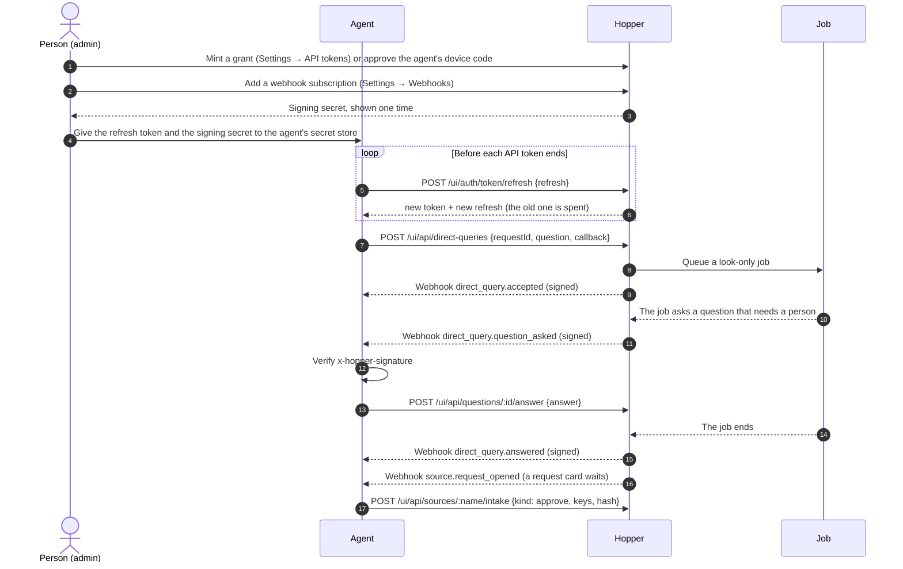

# Connect an agent to the hopper

This page tells you how to connect an outside agent (for example an assistant bot) and the hopper in a loop that goes
two ways:

1. The agent gives the hopper work and asks it questions, with a scoped API token.
2. The hopper calls the agent back on events: a job state, a question, a proposal, a request card that waits, the
   answer to a direct query.
3. The agent acts on these callbacks: it answers questions and approves request cards in Intake.

Each step names the code that does it, so you can check it. The paths are relative to the repository root.

Read these first for the full rules: [API tokens and grants](../help/api-tokens.md),
[Remote access](../help/remote-access.md), [The vault](../help/vault.md) and [docs/events.md](events.md).

## Rules

- **No `.env` files.** The hopper keeps every secret it owns in its vault, sealed under the master key
  (`src/vault/system.ts`). You set them in the UI, never in a file. The agent keeps its own secrets in its own secret
  store.
- **Remote access is off by default** (`src/http/remote-access.ts`, the default setting `{ enabled: false }`). An agent
  on another network reaches the hopper only after the hopper's admin turns it on. See [Reach the hopper from another
  network](#reach-the-hopper-from-another-network).
- **Use each refresh token one time, from one place.** One process holds the grant. When a spent refresh token comes
  again after the grace window, the hopper ends the whole grant (`src/http/ui/api-grants.ts`). See
  [Keep the grant](#2-keep-the-grant).
- **Give the least scopes.** A grant can do only what its scopes name. Every other route gets `403`.
- **No real secrets, host names or personal details in examples.** The examples on this page use
  `hopper.example.com`, `agent.example.com` and `my-agent`. Put your own values only in your own secret store.

## The loop



## 1. Mint a grant for the agent

A **grant** lets the agent act for a person over the API, without a person there. A person makes it one time. The
agent then gets short-lived API tokens from it by itself.

- The grant gives two tokens one time: a **refresh token** (`hopper_rt_…`) and an **API token** (`hopper_at_…`)
  (`src/domain/sign-in.ts`, `REFRESH_TOKEN_PREFIX` and `API_TOKEN_PREFIX`). The hopper keeps only their hashes.
- An API token lives 10 minutes by default. The hopper's admin sets 5 to 15 minutes in **Settings → API tokens**
  (`API_TOKEN_MINUTES` in `src/domain/sign-in.ts`).
- A grant ends 90 days after it is made by default (1 to 365, `--days`), or 30 days after its last refresh, or when a
  person revokes it (`GRANT_DEFAULT_DAYS`, `GRANT_MAX_DAYS`, `GRANT_IDLE_DAYS` in `src/domain/sign-in.ts`).
- Its role is at most the role of the person who mints it. At each refresh the hopper reads that person's role again: a
  lower role lowers the grant, and no role ends it (`src/http/ui/api-grants.ts`).
- An API token never mints a grant (`403`, `src/http/ui/api-tokens.ts`).

### Scopes

A scope names routes by their area and their act. The rule is in `src/domain/token-scopes.ts` (`scopeOfRoute`):

| Route | Scope |
|---|---|
| `GET /api/<area>/…` | `<area>:read` |
| `POST /ui/api/<area>/…/<act>` | `<area>:<act>` |
| `POST /ui/api/<area>` | `<area>:edit` |
| A route whose body names one of several actions in `action` or `kind` | also `<route scope>.<action>`, for one action only |

A grant can hold `<area>:<act>`, `<area>:*`, `*:<act>` or `*`. A route that its scopes do not cover gets `403`, and the
answer names the scope it needs (`grantScopeRefusal` in `src/http/ui/api-tokens.ts`). To see every scope with its routes,
least role and box flag, run `hopper token scopes` or read `GET /api/scopes` (`src/http/scopes.ts`,
`src/domain/scope-registry.ts`).

A **box action** starts a job, runs a command, approves or merges work, updates the hopper, or changes the work on a
machine. Only an API token of a **box grant** does a box action (`src/http/ui/box-actions.ts`, `BOX_ACTIONS`). Only a
person makes a box grant.

### The scopes of each step of the loop

| Step | Route | Scope | Least role | Box action |
|---|---|---|---|---|
| Read jobs, questions, proposals, research, sources | `GET /api/jobs`, `/api/questions`, `/api/proposals`, `/api/research`, `/api/sources` | `jobs:read`, `questions:read`, `proposals:read`, `research:read`, `sources:read` (or `*:read`) | viewer | no |
| Ask a direct query | `POST /ui/api/direct-queries` | `direct-queries:edit` | operator | yes |
| Read a direct query | `GET /api/direct-queries/:requestId` | `direct-queries:read` | viewer | no |
| Give a direct job (work with no GitHub issue) | `POST /ui/api/direct-jobs` | `direct-jobs:edit` | operator | yes |
| Answer a question | `POST /ui/api/questions/:id/answer` | `questions:answer` | operator | yes |
| Approve a request card | `POST /ui/api/sources/:name/intake` with `kind: approve` | `sources:intake.approve` (or `sources:intake`) | operator | yes |
| Approve a held job | `POST /ui/api/jobs/:id/approve` | `jobs:approve` | operator | yes |
| Add or change a webhook subscription | `POST /ui/api/webhooks` | `webhooks:edit` | admin | no |

The roles come from each route's `role` in the API reference (`src/http/openapi.ts` and the route files in
`src/http/ui/`).

### Presets

A preset is a named set of scopes (`PRESETS` in `src/domain/scope-registry.ts`):

| Preset | Scopes | Box grant |
|---|---|---|
| `read-only` | `*:read` | no |
| `agent-intake` | `*:read`, `sources:intake` | yes |
| `agent-approvals` | `*:read`, `sources:intake`, `jobs:approve`, `jobs:grant-vault` | yes |
| `delegate-approver` | `vault:read`, `jobs:grant-vault`, `jobs:deny-vault`, `vault:edit.approve-template`, `sandbox-requests:edit.approve`, `sandbox-requests:edit.decline`, `sandbox-requests:edit.approve-run`, `sandbox-requests:edit.decline-run` (`DELEGATE_SCOPES` in `src/domain/delegates.ts`) | yes |
| `full-admin` | `*` | yes |

No preset holds `questions:answer` or `direct-queries:edit`. For the loop on this page, start from a preset and add the
scopes you need:

| The agent's role in the loop | Mint it with |
|---|---|
| Only watches (reads, gets callbacks) | `--preset read-only` |
| Approves request cards | `--preset agent-intake`, or better `--scope '*:read' --scope sources:intake.approve --box` |
| Asks direct queries and answers their questions | `--scope '*:read' --scope direct-queries:edit --scope questions:answer --box` |
| The full loop on this page | `--scope '*:read' --scope direct-queries:edit --scope questions:answer --scope sources:intake.approve --box` |

Least privilege:

- Prefer one action scope (`sources:intake.approve`) to the route scope (`sources:intake`). The route scope also lets
  the agent assign, release, decline and take in items.
- Give the role `operator`. The routes of the loop need no more. A webhook subscription is the admin's, set in the UI.
- Limit the grant to the repositories and job sources it works on: `--repo owner/name`, `--source <name>`
  (`src/domain/grant-limits.ts`). A limit applies to changes only, never to reads.
- Tie the grant to the agent's key with DPoP when the agent can sign proofs. Then a copied refresh token alone does not
  work (`src/http/ui/dpop.ts`). See "Tie a grant to the agent's key" in [API tokens and grants](../help/api-tokens.md).

### Mint it

In the UI: **Settings → API tokens → Mint grant**. Copy the refresh token one time, into the agent's secret store.

From the command line, on the hopper's host (`src/cli-operator-keys.ts`):

```sh
hopper token mint --label "my agent" --holder my-agent --role operator --box \
  --scope '*:read' --scope direct-queries:edit --scope questions:answer --scope sources:intake.approve \
  --repo owner/name
hopper token list
hopper token revoke <id>
```

The command prints the answer as JSON one time: `grant`, `token`, `expiresAt`, `refresh`, and `view`
(`ApiGrantMinted` in `src/domain/sign-in.ts`).

Or let the agent ask for the grant with a device code, so no person copies a token:
`POST /ui/auth/device-grant`, then a person approves the code in **Settings → API tokens → Approve a device**, then the
agent polls `POST /ui/auth/device-grant/poll` (`src/http/ui/api-tokens.ts`, `src/http/ui/device-grants.ts`). The steps
are in "Let an agent ask for a grant" in [API tokens and grants](../help/api-tokens.md).

## 2. Keep the grant

Before its API token ends, the agent gets a new pair:

```http
POST /ui/auth/token/refresh
content-type: application/json

{ "refresh": "hopper_rt_…" }
```

The answer (`ApiTokenRefreshed` in `src/domain/sign-in.ts`):

| Field | What it is |
|---|---|
| `grant` | the grant's id |
| `token` | the new API token |
| `expiresAt` | when the new API token ends |
| `refresh` | the new refresh token. The old one is spent |
| `tokenType` | `DPoP` when the grant is tied to a key; absent otherwise |

Errors: `400` for a bad body, `401` for a refresh token that is unknown, spent or of a grant that ended, `429` for more
than 20 refreshes a minute from one caller (`SIGN_IN_RATE` in `src/http/ui/sign-in.ts`). Through remote access the
limit is 5 a minute.

**Use each refresh token one time, from one place:**

- The hopper rotates the refresh token in one database transaction (`rotate` in `src/store/api-grants.ts`).
- A retry with the same refresh token within 30 seconds gets the same pair, so a short network fault loses nothing
  (`REFRESH_GRACE_MS` in `src/domain/sign-in.ts`). After a hopper restart inside that window, the retry gets `401` and
  the grant stays.
- A spent refresh token that comes after the 30 seconds can be a stolen one. The hopper ends the whole grant and all
  its API tokens. It records `api_grant.reuse_detected`, then `api_grant.revoked` with the reason `reuse-detected`.
- So: one process holds the grant. Two processes that refresh the same grant end it. Give each agent its own grant.
- Subscribe a webhook to `api_grant.reuse_detected` to be told.

**Keep the new refresh token before you use the new API token.** If the agent stops between the refresh and the save,
it holds only a spent token, and a person must mint a new grant.

1. Send the refresh.
2. Write the new `refresh` into the agent's secret store, atomically: the new value replaces the old one in one step, or
   not at all.
3. Only then use `token`.

When the agent's store is a file (for example a mounted secret volume), write a temporary file next to it with mode
`600`, then rename it over the old file. A rename on the same file system is atomic. The hopper's own command line does
this when you set `HOPPER_REFRESH_TOKEN_FILE` (`src/cli-operator.ts`), and so does
`scripts/out-of-band-collector.ts`. Neither of them sends DPoP proofs, so they work only with a grant that is not tied
to a key.

```ts
import { renameSync, writeFileSync } from 'node:fs';

/** Replaces the kept refresh token in one step: a reader sees the old value or the new one, never half of one. */
function keepRefresh(file: string, refresh: string): void {
  const tmp = `${file}.${process.pid}.tmp`;
  writeFileSync(tmp, refresh, { mode: 0o600 });
  renameSync(tmp, file);
}
```

Use the API token on each call:

```sh
curl -H "Authorization: Bearer $HOPPER_TOKEN" https://hopper.example.com/api/questions
```

A grant tied to a key uses `Authorization: DPoP <token>` and a `DPoP` proof header (`src/http/ui/guard.ts`,
`src/http/ui/dpop.ts`).

## 3. Add a webhook subscription

A **webhook subscription** tells the hopper where to send events. Subscriptions are rows in the hopper's database
(`src/store/webhooks.ts`), and only the UI session of the hopper's admin, or an admin's API token, changes them
(`POST /ui/api/webhooks`, `src/http/ui/webhooks-notifiers.ts`). No file holds them.

In the UI: **Settings → Webhooks**, add a subscription with a name, the agent's URL and the events.

Over the API (`webhooksEditBody` in `src/http/ui/webhooks-notifiers.ts`):

```http
POST /ui/api/webhooks
content-type: application/json

{ "action": "add", "name": "my-agent", "url": "https://agent.example.com/hopper",
  "events": ["question.escalated_to_human", "source.request_opened", "proposal.escalated_to_human",
             "research.escalated_to_human", "job.finished", "job.failed", "approval.confirmation_asked",
             "api_grant.reuse_detected"] }
```

| `action` | Fields | What it does |
|---|---|---|
| `add` | `name`, `url`, `events`, `active?`, `secret?` | Adds a subscription. The name is fixed after this |
| `edit` | `name`, `url?`, `events?`, `active?` | Changes it |
| `replace` | `name`, `secret` | Replaces the signing secret with the one you type |
| `rotate` | `name` | The hopper makes a new signing secret |
| `remove` | `name` | Removes it and its signing secret. Its waiting deliveries become `failed` |

- `url` is `http` or `https`. `events` holds at least one event type, or `*` for all (`src/webhooks/edit.ts`).
- The match is by the exact event type. There are no patterns (`src/webhooks/dispatcher.ts`).
- The answer is the list of subscriptions (as `GET /api/webhooks`). When the hopper made the secret (an `add` with no
  `secret`, or a `rotate`), the answer also holds `generatedSecret`, one time only. Copy it into the agent's secret
  store.
- Errors: `400` invalid, `404` no such subscription, `409` the name exists, `503` no master key.
- `POST /ui/api/webhooks/test` with `{ "name": "my-agent" }` sends one signed test event, one attempt, and stores nothing.
- `GET /api/webhooks/deliveries?subscriptionId=<id>` lists the deliveries, newest first (`src/http/webhooks.ts`).

### Where the signing secret lives

- **On the hopper:** the signing secret is a **system secret** in the vault, the row
  `system/webhook.<subscription id>.signing-secret` (`src/webhooks/secrets.ts`, `src/domain/vault.ts`). It is sealed under
  the master key and written only through `SystemSecrets.keep` (`src/vault/system.ts`). No route answers it again, and
  no job, machine or box gets it. **Settings → Vault** shows its audit trail, never its value.
- **On the agent:** keep the copy in the agent's own secret store, with its refresh token. Never in a file in a
  repository, never in an `.env` file, never in a log.
- A typed secret has 32 to 4096 printable ASCII characters and no spaces. A secret the hopper makes has 64 hex
  characters (`src/webhooks/secrets.ts`, `makeSecret`).
- Without the master key the hopper keeps no secret: an `add` gets `503`.

### Events for the loop

Each event's fields and its JSON Schema are in [docs/events.md](events.md) and `docs/schemas/<type>.v<N>.json`.

| The agent wants to know | Event type |
|---|---|
| A question waits on a person | `question.escalated_to_human` (`data.questionId`) |
| A question was answered or closed | `question.answered`, `question.closed`, `question.dismissed` |
| A proposal or a research report waits on a person | `proposal.escalated_to_human`, `research.escalated_to_human` |
| A request card waits in Intake | `source.request_opened` (`source`, `key`, `hash`) |
| A request card was approved or declined | `source.request_approved`, `source.request_auto_approved`, `source.request_declined` |
| A job's state | `job.queued`, `job.started`, `job.waiting`, `job.parked`, `job.finished`, `job.failed`, `job.cancelled` |
| A direct query | `direct_query.accepted`, `direct_query.answered`, `direct_query.failed`, `direct_query.cancelled`, `direct_query.question_asked` |
| An approval needs a person to confirm it | `approval.confirmation_asked` |
| Someone sent a spent refresh token | `api_grant.reuse_detected` |

### What a delivery looks like

The webhook dispatcher (`src/webhooks/dispatcher.ts`) follows the event log and sends each event to each active
subscription whose `events` hold its type or `*`:

```http
POST https://agent.example.com/hopper
content-type: application/json
x-hopper-event: direct_query.answered
x-hopper-delivery: <delivery id>
x-hopper-timestamp: <unix seconds>
x-hopper-signature: sha256=<hex HMAC-SHA256(secret, "<timestamp>.<raw body>")>

{ "schemaVersion": 1, "seq": 42, "id": "…", "type": "direct_query.answered", "at": "…", "jobId": "…", "data": { … } }
```

The body is the event, as stored: the envelope of [docs/events.md](events.md) (`docs/schemas/envelope.v1.json`).

### Retries and backoff

From `src/webhooks/dispatcher.ts`:

- A `2xx` answer within 5 seconds is delivered. Any other answer (a `4xx` too), a network fault or a timeout is a
  failure.
- After attempt `n` fails, the next attempt is at `now + min(1 s × 2^(n-1), 300 s)`: 1 s, 2 s, 4 s, 8 s, 16 s.
- After 6 attempts the delivery is `failed`. The hopper does not send it again.
- Waiting deliveries are kept in the database and live through a restart.
- Delivery is **at least once**: the same event can come twice. Dedupe on `x-hopper-delivery`.
- Each destination has an outbound guard (`src/domain/outbound.ts`): a burst of 60, then 5 a second. A send with no
  token waits, and spends no attempt. Above 600 asks in 60 seconds the circuit opens for 5 minutes, and a delivery
  asked meanwhile fails.

So: answer `2xx` at once, then do the work. A slow answer counts as a failure and comes again.

## 4. Verify the signature

Do this for each delivery, before you read the body:

1. Read the raw body, as bytes, before a JSON parser changes it.
2. Read `x-hopper-timestamp`.
3. Compute the HMAC-SHA256 of `<timestamp>.<raw body>` with the signing secret, as hex, and put `sha256=` before it.
4. Compare it with `x-hopper-signature` in constant time. If they differ, answer `401` and do nothing.
5. Refuse a timestamp that is too old (for example more than 5 minutes). The hopper does not check this for you: a
   check on the agent's side stops a replay of an old delivery. A retry has a new timestamp and a new signature.
6. Refuse a `x-hopper-delivery` you saw before, with `2xx`.

The hopper signs with `sign` in `src/webhooks/signer.ts`, and `verify` there is the same check:

```ts
import { createHmac, timingSafeEqual } from 'node:crypto';

/** True when the delivery is the hopper's: its signature matches, and it is at most five minutes old. */
export function verifyHopper(secret: string, rawBody: string, timestamp: string, signature: string): boolean {
  const ageS = Math.abs(Date.now() / 1000 - Number(timestamp));
  if (!Number.isFinite(ageS) || ageS > 300) return false;
  const want = Buffer.from(`sha256=${createHmac('sha256', secret).update(`${timestamp}.${rawBody}`).digest('hex')}`);
  const got = Buffer.from(signature);
  return want.length === got.length && timingSafeEqual(want, got);
}
```

## 5. The agent gives the hopper work

The hopper pulls its jobs. No route takes a job from outside, but these:

| Way | How | What comes of it |
|---|---|---|
| A GitHub or GitLab issue | The agent files an issue on a job repository, with the job source's label | A job only when the user's trusted actors wrote, labelled and assigned it. Any other issue is a **request card** that waits for approval in Intake ("Jobs come only from a trusted origin" in `AGENTS.md`; `docs/design.md` "Trusted origin and request cards") |
| A direct job | `POST /ui/api/direct-jobs` with `title`, `brief`, `labels`, `authorizations`, `repo` | A job with no issue, queued at once from the job source `direct` (`src/http/ui/direct-jobs.ts`) |
| A direct query | `POST /ui/api/direct-queries` | A job that only looks, and a callback with its answer (below) |

An issue that the agent files through its own GitHub account is not of a trusted origin when that account is no trusted
actor. Then a person, or the agent through step 7, approves its request card.

### Ask a direct query

A **direct query** is a question with no GitHub issue. A job that only looks answers it: the GitHub proxy refuses its
writes, and the git proxy refuses its pushes (`LOOK_ONLY` in `src/domain/direct-jobs.ts`).

```http
POST /ui/api/direct-queries
authorization: Bearer hopper_at_…
content-type: application/json

{ "requestId": "r-42", "question": "Which deployment runs the log collector?", "callback": "my-agent",
  "repos": ["owner/name"] }
```

The body (`directQueryBody` in `src/http/ui/direct-queries.ts`):

| Field | Rule |
|---|---|
| `requestId` | required, 1 to 200 characters: the agent's own id. The same id again gets the kept query with `replayed: true`, and makes nothing. The same id with another question or callback gets `409` |
| `question` | required, 1 to 16000 characters |
| `callback` | optional: the **name** of an active webhook subscription, not a URL. `400` when no active subscription has that name |
| `mode` | `look` (the default). `change` gets `422`: give a direct job or file an issue |
| `repos`, `clusters` | optional, at most 20 each: where to look first. They allow nothing |
| `labels` | optional, at most 20 routing labels, beside `direct:query` |
| `executor`, `priority` | optional; `priority` 0 to 100 |

The answer: `{ directQuery, job?, replayed? }`. Read it again with `GET /api/direct-queries/:requestId`. Cancel it with
`POST /ui/api/jobs/:id/cancel`.

Use a `requestId` that stays the same when the agent sends the query again after a fault. Then a retry makes no second
job.

## 6. The hopper calls back

### The direct-query callback

The hopper sends each `direct_query.*` event of the query to the subscription that `callback` names, whatever events
that subscription lists (`src/webhooks/dispatcher.ts`). It is signed, kept and retried as every delivery. The fields are
in [docs/events.md](events.md):

| Event | When | Fields the agent uses |
|---|---|---|
| `direct_query.accepted` | The query is kept and its job is queued | `id`, `requestId` |
| `direct_query.question_asked` | Its job asked a question that reached a person | `questionId`, `question` (masked), `answerUrl` |
| `direct_query.answered` | Its job finished | `answer`, `artifacts`, `url` |
| `direct_query.failed` | Its job failed or was turned away | `error`, `url` |
| `direct_query.cancelled` | Its job was cancelled | `url` |

Each one carries `id`, `requestId` and `callback`. Match the callback to the query by `requestId`. The `artifacts` links
need a hopper sign-in.

A subscription that lists `direct_query.answered` or `*` gets the answer of every direct query, not only the queries
that name it (`docs/design.md` "Direct queries"). Give such a subscription only to a receiver that may read them all.

### Inbound webhooks

The hopper takes one inbound webhook only: GitHub's `issues` events at `POST /github/webhook`, signed with
`X-Hub-Signature-256` and the GitHub webhook secret, a system secret the admin makes in **Settings → GitHub webhook**
(`src/http/github-deliveries.ts`, `src/domain/github-deliveries.ts`). A delivery only makes the issue's repository due
at the next sync. It carries no job and changes no job. An agent does not trigger work through it: the agent uses the
API routes of step 5.

## 7. The agent acts on a callback

### Answer a question

From `question.escalated_to_human` (`data.questionId`) or `direct_query.question_asked` (`data.questionId`):

```http
POST /ui/api/questions/<question id>/answer
authorization: Bearer hopper_at_…
content-type: application/json

{ "answer": "the observability cluster" }
```

It needs `questions:answer` and a box grant. `404`: no such question. `409`: it is not open any more, for example a
person answered first (`src/http/ui/index.ts`, `answerBody` in `src/http/ui/job-bodies.ts`). The job goes on with the
answer.

### Approve a request card

From `source.request_opened`, take `source`, `key` and `hash`:

```http
POST /ui/api/sources/<source>/intake
authorization: Bearer hopper_at_…
content-type: application/json

{ "kind": "approve", "keys": ["<key>"], "hash": "<hash>" }
```

- It needs `sources:intake.approve` (or `sources:intake`) and a box grant.
- An approve names one item and the SHA-256 of its title and body (`intakeActionBody` in `src/http/ui/job-bodies.ts`).
  The job runs the text of that hash. When the text changed since, the card opens again with a new hash: the agent reads
  it again before it approves.
- Access decides first (OpenFGA `item#can_accept_text`): `403` refused, `503` the access service does not answer
  (`src/http/ui/source-intake.ts`).
- The answer is `{ done, failed }`.

Approve only what the agent's own rules let it approve. **Auto-approval** (on by default) already approves a card that a
trusted actor wrote, reopened or labelled `hopper:high` (`src/http/ui/intake-auto-approval.ts`,
`docs/design.md` "Auto-approval"). The rest waits for a person or for the agent.

### What the agent cannot approve

Some approvals need a person, whatever the token. An infra plan whose risk is not low, and a template's write, sync or
apply profile, get `202` with `waiting`: the hopper records `approval.confirmation_asked` and asks a person
("What a person confirms" in [API tokens and grants](../help/api-tokens.md)).

## Reach the hopper from another network

The daemon binds `127.0.0.1`. An agent on the same host reaches it on loopback. Other ways, from the narrowest:

| Way | What to do | Risk |
|---|---|---|
| Loopback | Run the agent on the hopper's host | None from the network |
| The LAN or a tailnet | The admin sets `HOPPER_LAN_PEERS` (`src/config.ts`) | Every LAN peer named can try the API; each request still needs a token |
| A reverse proxy | `HOPPER_PUBLIC_URL`, and `HOPPER_LAN_PEERS` for a proxy on another host (`docs/sign-in.md`) | The proxy is on the internet's path |
| Remote access | The admin turns it on in **Settings → Remote access** with Cloudflare Tunnel or ngrok ([Remote access](../help/remote-access.md)) | See below |

A request from the LAN or a public URL reads `/api/` only with a UI session or an API token (`src/http/host-guard.ts`).

**Remote access** is optional and **off by default**. Only the hopper's admin turns it on (`POST /ui/api/remote-access`,
`src/http/ui/remote-access.ts`). The provider's one credential is a system secret in the vault, never in a file:
`remote-access.cloudflare-api-token` or `remote-access.ngrok-api-key` (`src/domain/vault.ts`).

While it is on:

- Only the API goes through the tunnel: `/api/` (not the event stream), `/ui/api/`, `/ui/auth/api-token`,
  `/ui/auth/token/refresh`, `/ui/auth/device-grant` and its poll. The UI gets `404` (`src/domain/remote-access.ts`,
  `src/http/tunnel.ts`).
- Each caller gets 120 requests a minute, and 5 token exchanges or refreshes a minute (`429` above).
- A request through the tunnel is a public request: it reads or changes something only with an API token.

Its risks (`docs/design.md` "Remote access", `docs/deploy.md`):

- The tunnel service is third-party code on the internet's path. It holds the tunnel token in memory while the tunnel
  runs.
- The Cloudflare API token can make tunnels and change DNS records in its zone. Give it one zone only.
- Callers behind one address (a NAT) share one rate limit.
- The API is reachable from the whole internet. A stolen refresh token works from anywhere until the grant ends: tie
  the grant to the agent's key, limit it, and subscribe to `api_grant.reuse_detected`.

Turn remote access off when the agent does not need it.

## Walkthrough

1. **Mint the grant.** In **Settings → API tokens**, mint a box grant with the role `operator`, the scopes `*:read`,
   `direct-queries:edit`, `questions:answer` and `sources:intake.approve`, and the repositories it works on. Or let the
   agent ask with a device code. Put the refresh token into the agent's secret store.
2. **Add the webhook.** In **Settings → Webhooks**, add `my-agent` with the agent's URL and the events of
   [Events for the loop](#events-for-the-loop). Leave the secret empty: the hopper makes one.
3. **Keep the callback key.** Copy the signing secret the hopper shows one time into the agent's secret store. The
   hopper keeps its own copy in its vault as a system secret. Send a test event (**Send test event**, or
   `POST /ui/api/webhooks/test`) and check that the agent verifies it.
4. **Refresh.** The agent trades its refresh token for an API token, and keeps the new refresh token atomically before
   it uses the API token.
5. **Give work.** The agent asks a direct query with a `requestId` and `"callback": "my-agent"`, or files an issue.
6. **The hopper calls back.** The agent gets `direct_query.accepted`, then perhaps `direct_query.question_asked`, then
   `direct_query.answered`. For an issue it filed, it gets `source.request_opened` while the card waits.
7. **Answer or approve.** The agent answers the question with `POST /ui/api/questions/:id/answer`, or approves the card
   with `POST /ui/api/sources/:name/intake`.
8. **Verify each delivery.** Before step 7, the agent checks `x-hopper-signature`, the timestamp's age and the delivery
   id.

## When something fails

| You see | Why | Do this |
|---|---|---|
| `401` at the refresh | The refresh token is spent, unknown, or its grant ended | A person mints a new grant. Check that only one process refreshes |
| `403` "it needs the scope …" | The grant's scopes do not cover the route | Mint a grant with that scope |
| `403` "this is a box action: it needs a box token" | The grant is no box grant | A person mints a box grant |
| `400` "no active subscription" at a direct query | `callback` names no active subscription | Add it in **Settings → Webhooks**, or turn it on |
| `409` at an answer | The question is not open | Read the question again: a person may have answered |
| No callbacks come | The deliveries fail | Read `GET /api/webhooks/deliveries`: `lastStatusCode` and `lastError` say why |
| The agent gets the same event twice | Delivery is at least once | Dedupe on `x-hopper-delivery` |
